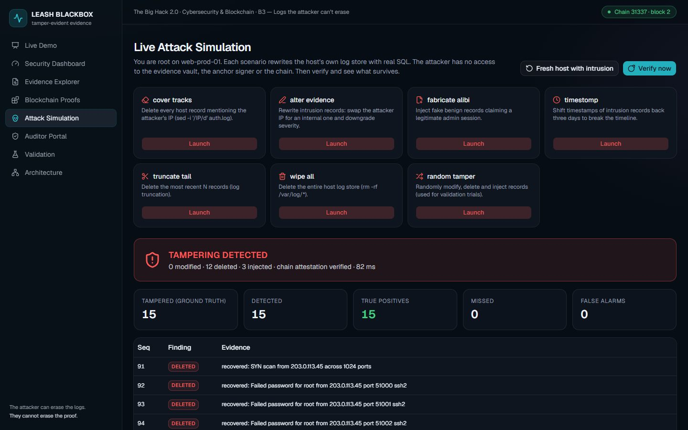
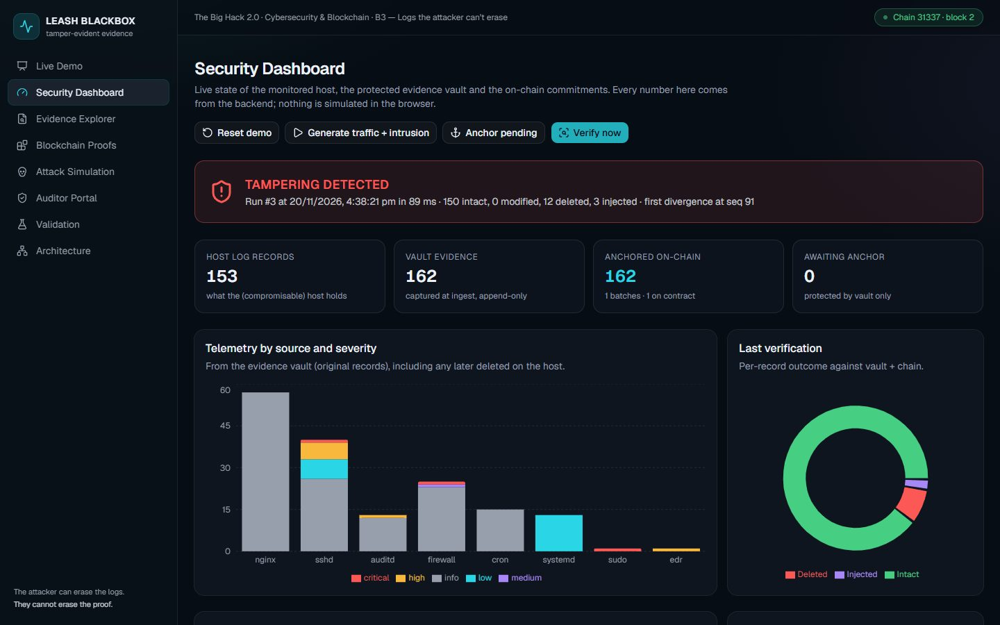
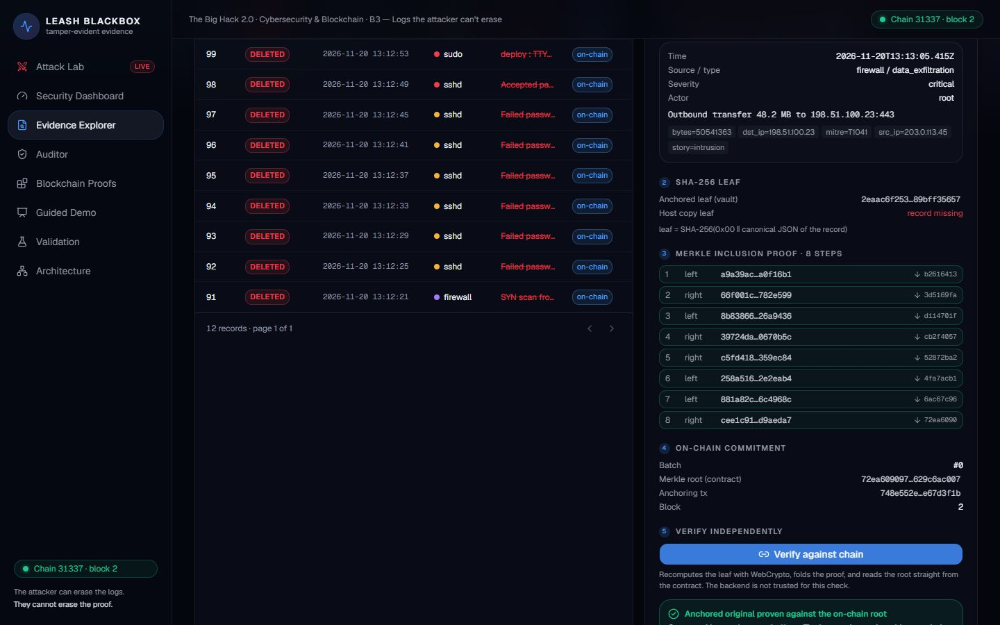
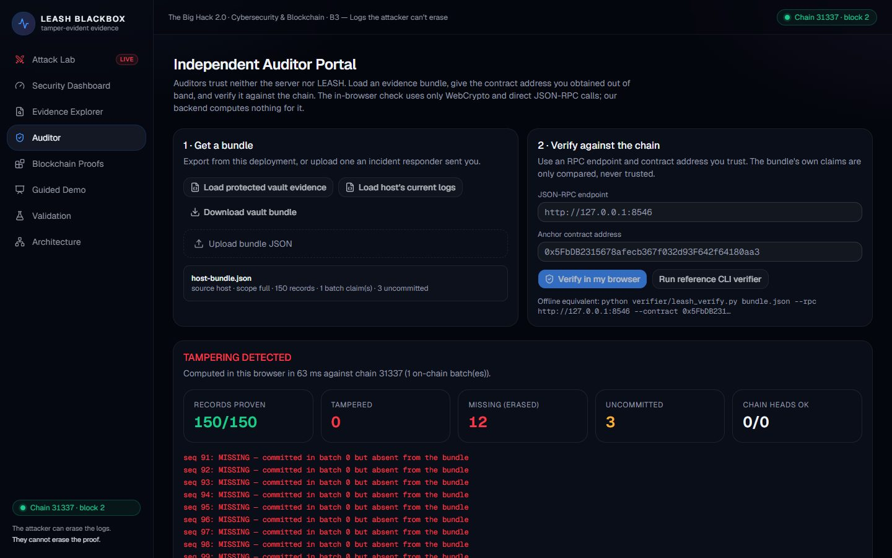

# LEASH BLACKBOX

> **The attacker can erase the logs. They cannot erase the proof.**

**The Big Hack 2.0** · **Track 02 — Cybersecurity and Blockchain** · **Problem B3 — Logs the Attacker Can't Erase**



## The problem

When attackers gain root on a server, they delete or rewrite its logs to hide what they did (MITRE ATT&CK
T1070). Investigators, insurers and regulators then depend on evidence the attacker controlled. Signing logs
locally does not help: the signing key sits on the compromised machine.

## Our solution

LEASH BLACKBOX makes historical security evidence **tamper-evident and independently verifiable**:

1. **Canonicalize and hash.** Every security event is serialized deterministically and hashed with SHA-256
   (`leaf = SHA256(0x00 ‖ record)`). Leaves are linked into a hash chain (`chain = SHA256(0x02 ‖ prev ‖ leaf)`).
2. **Get the evidence off the host.** A collector outside the monitored host keeps an append-only evidence vault
   (UPDATE and DELETE are blocked by database triggers).
3. **Anchor on a blockchain.** Events are batched into Merkle trees. Each batch's root, hash-chain head and
   manifest hash are committed to the **LeashAnchor** smart contract.
   - The contract has no update or delete function and enforces contiguous sequence numbers.
   - The signing key never touches the host.
4. **Verify.** The verifier recomputes everything from what the host still holds and compares it with the vault
   and the on-chain commitment. Every record comes out **INTACT**, **MODIFIED** (with a field-level diff),
   **DELETED** (the original is recovered from the vault and proven against the chain) or **INJECTED**.
5. **Audit independently.** Auditors verify exported evidence without trusting us:
   - a single-file, dependency-free Python verifier, or
   - their own browser, using WebCrypto and direct JSON-RPC calls to the contract.

## Architecture

```
 ┌────────── monitored host (attacker has root) ──────────┐
 │ telemetry ─► host agent ─► host_logs.db                 │ ◄── attack lab edits / deletes / injects here
 └──────────────────────────┬─────────────────────────────┘
                            │ forwarded at ingest
 ┌────────── collector / evidence zone (outside host) ────┐
 │ canonical JSON → SHA-256 leaf → hash chain              │
 │ evidence.db (append-only) → Merkle batch → anchor svc   │ (holds the signing key)
 └──────────────────────────┬─────────────────────────────┘
                            │ anchorBatch(root, chainHead, manifestHash, firstSeq, lastSeq, count)
 ┌────────────── independent EVM chain ───────────────────┐
 │ LeashAnchor.sol: append-only, contiguous ranges         │
 └──────────────────────────┬─────────────────────────────┘
                            │ eth_call / receipts
     verifier (backend) · leash_verify.py (auditor CLI) · in-browser verifier (web)
```

Design decisions and the threat model are in [`docs/handoff/ARCHITECTURE_DECISIONS.md`](docs/handoff/ARCHITECTURE_DECISIONS.md).

## Technology stack

| Layer | Technology |
|---|---|
| Smart contract | Solidity 0.8.24, Hardhat 2 (local EVM node, chain id 31337) |
| Backend | Python 3.11+, FastAPI, SQLAlchemy, SQLite (separate host / vault / lab stores), web3.py |
| Cryptography | SHA-256, canonical JSON, hash chain, Merkle trees with inclusion proofs, Keccak-256 (ABI) |
| Auditor CLI | `verifier/leash_verify.py`, Python standard library only (its own Keccak-256 and ABI decoding) |
| Web console | Next.js 16, TypeScript, Tailwind CSS 4, shadcn/ui, Motion, Recharts, Lucide |
| Testing | pytest, Hardhat/Mocha, Playwright |

## Setup

Requirements: Git, Node.js 20+, Python 3.11+. Docker and Foundry are not needed.

```bash
git clone https://github.com/sanokiyo1029-sys/leash-blackbox.git
cd leash-blackbox
(cd blockchain && npm install)
python -m venv backend/.venv
backend/.venv/Scripts/python -m pip install -r backend/requirements.txt   # macOS/Linux: backend/.venv/bin/python
(cd frontend && npm install)
```

**One command (Windows).** Starts the chain, the API and the web console, waits until each answers, deploys a
fresh contract and seeds 120 events. Ctrl+C stops all three:

```powershell
scripts\start-all.cmd
```

The same script runs from PowerShell as `powershell -ExecutionPolicy Bypass -File scripts\start-all.ps1`. Options:
`-Dev` (use `next dev`, no build), `-NoSeed` (empty lab), `-Stop` (stop services left behind by a closed window).
It refuses to start if port 8545, 8000 or 3000 is already taken and names the program using it. It never stops
processes it did not start. Logs are written to `logs\`.

Or run three terminals by hand:

```bash
cd blockchain && npx hardhat node                                                    # 1. local chain on :8545
cd backend && .venv/Scripts/python -m uvicorn app.main:create_app --factory --port 8000   # 2. API (docs at /docs)
cd frontend && npm run dev                                                           # 3. web console on :3000
```

On Windows, keep the clone at a short path such as `C:\Users\<you>\leash-blackbox`: pip fails in very deep
folders when long paths are disabled. More detail is in [`docs/handoff/SETUP_AND_RECOVERY.md`](docs/handoff/SETUP_AND_RECOVERY.md).

## Run the live attack simulation

Open **http://localhost:3000/attack** (Attack Lab):

1. **Prepare lab.** This deploys a fresh LeashAnchor contract, streams 40 normal events plus a hidden intrusion
   kill chain, and anchors them on-chain.
2. **Verify integrity.** Every record matches the on-chain commitment, all connectors turn green, and the root
   rebuilt from the host equals the contract's root.
3. **Attack as root.** Use **Erase my trail**, **Launder evidence**, **Plant an alibi** or **Timestomp**, or the
   per-line erase/rewrite buttons. Each is a real write to the host's log database.
4. **Verify integrity again.** The verifier reports TAMPERING DETECTED and names every erased, altered and
   fabricated line. Erased originals are recovered from the vault, and the on-chain commitment is unchanged.

**Guided Demo** (`/demo`) runs the same story step by step for presentations. The API exposes the same actions
(`POST /api/attacks/{scenario}`, `POST /api/verify`). Lab endpoints can be switched off with `LEASH_DEMO_MODE=0`.

| Dashboard | Evidence Explorer | Independent auditor |
|---|---|---|
|  |  |  |

## How blockchain verification works

- **What goes on-chain:** for each batch, `merkleRoot`, `chainHead`, `manifestHash`, `firstSeq`, `lastSeq`,
  `eventCount`, plus the block timestamp and submitter. No log content goes on-chain; only 32-byte digests.
- **What the contract guarantees:**
  - There is no way to modify or delete a batch.
  - `firstSeq` must equal the previous `lastSeq + 1`, so gaps and overlaps revert.
  - Only allow-listed anchorers can append.
- **Checking a record:**
  1. Canonicalize the record and compute its SHA-256 leaf.
  2. Fold its Merkle inclusion proof.
  3. Compare the result with `getBatch(id).merkleRoot` read from the contract.
  4. Confirm the anchoring transaction receipt and its `BatchAnchored` event.
- **Detecting deletions:** a sequence number that is committed on-chain but missing from the host's copy is
  reported, and the hash-chain head must also match.
- **Three independent implementations agree:** the backend (Python), the CLI (Python standard library) and the
  browser (TypeScript + WebCrypto).

Verify an exported bundle yourself:

```bash
curl -s "localhost:8000/api/export?source=host" -o host_bundle.json
python verifier/leash_verify.py host_bundle.json --rpc http://127.0.0.1:8545 --contract <address>
# exit 0 = VERIFIED, exit 2 = TAMPERING_DETECTED
```

## Forward a real log file

`agent/tail_agent.py` (Python standard library only) forwards a syslog / auth.log style or JSON-lines file to the
collector and later checks the file against the chain:

```bash
cp agent/sample/auth.log data/demo-auth.log                     # synthetic auth.log with an intrusion
python agent/tail_agent.py ingest data/demo-auth.log --seal     # forward new lines, anchor them right away
python agent/tail_agent.py check data/demo-auth.log             # MATCHES (exit 0)
# now delete or edit a line in data/demo-auth.log, as an attacker with root would
python agent/tail_agent.py check data/demo-auth.log             # TAMPERING_DETECTED (exit 2), with the original text
```

- **No duplicates:** `ingest` sends only complete new lines, in file order, and keeps its byte offset in
  `<file>.leash-state.json`. `--follow` keeps polling.
- **Refuses a rewritten file:** if lines it already sent have changed, it stops (exit 2) instead of resending them.
- **Nothing silently dropped:** lines in an unknown format are still committed as `unparsed` raw text. Lines longer than
  4096 characters are reported and skipped.
- **Independent check:** `check` first proves the vault evidence against the chain with `verifier/leash_verify.py`.
  It then compares the file line by line and reports `ERASED` (with the original text), `ALTERED`, `INJECTED`, and
  trailing lines that are not committed yet.
- **Token:** set `LEASH_INGEST_TOKEN` to the shared token or to this host's own token. With a host token, pass
  `--host <that host>` so lines without a host header are attributed to it.

**Per-host credentials (API side).** Set `LEASH_HOST_TOKENS=web-prod-01=<sha256 of its token>,db-01=<…>`. Only the
hashes are configured. A host token may submit events only for its own host: any other `host` in the request gets a
403, and nothing in that request is stored. Listing a host twice lets you rotate its token. `.env.example` has a
one-line generator. The shared `LEASH_INGEST_TOKEN` keeps working; leave it unset to force per-host tokens.

## Test results

All of these were measured on a real local EVM node:

| Suite | Command | Result |
|---|---|---|
| Contract | `cd blockchain && npx hardhat test` | 9 passing |
| Backend + verifier + file agent | `cd backend && .venv/Scripts/python -m pytest` | 90 passed |
| Web end-to-end (screens, attack flow, mobile/tablet overflow, console errors) | `cd frontend && npm run test:e2e` | 23 passed |
| Validation experiments | `backend/.venv/Scripts/python scripts/run_validation.py --trials 30` | see below |

From [`docs/validation/RESULTS.md`](docs/validation/RESULTS.md):
- 30 randomized tampering trials with 476 tampered host records gave **100% recall and 100% precision**.
- Clean runs produced 0 false alarms.
- The independent CLI agreed in 30 of 30 trials.
- Each named attack scenario (cover tracks, alter, fabricate, timestomp, truncate, wipe) was detected exactly.
- On-chain cost is about **148.5k gas per batch** whatever its size, which is about 145 gas per event at
  1,024 events per batch.
- Full verification of 5,000 events takes about 0.8 s.

Detection is a deterministic hash comparison, so these trials check implementation correctness. They are not a
statistical accuracy claim.

## Known limitations

- **Source-side attacks:** events forged at the source after compromise, or suppressed before they are
  forwarded, cannot be detected. Forwarding at ingest narrows that window but cannot close it.
- **Unanchored events:** events in the vault but not yet anchored are protected only by storage separation. The
  UI labels them "vault only".
- **Single machine:** the prototype runs every zone on one machine, with separate stores and a local Hardhat
  chain. Production would put them on separate infrastructure and anchor to a public or consortium chain.
  Public testnet anchoring is not implemented yet.
- **Ingest authentication:** per-host tokens (`LEASH_HOST_TOKENS`) bind a token to one host name. They do not stop a
  compromised host from sending false events about itself, and there is no rate limiting or mTLS. Without them,
  the single shared `LEASH_INGEST_TOKEN` lets any holder submit events under any host name.
- **Local chain state:** the Hardhat node keeps its state in memory. Restarting it requires a lab reset.
- **File agent:**
  - Edits to a forwarded file are found by `tail_agent.py check`, not by the dashboard's `/api/verify`, which checks
    the simulated host store.
  - Records are matched to a file by its file name.
  - RFC 3164 timestamps carry no year or zone, so the current year and UTC are assumed.

## Repository layout

| Path | Contents |
|---|---|
| `blockchain/` | `LeashAnchor.sol`, Hardhat tests, deploy and ABI export scripts |
| `shared/` | Exported ABI and bytecode |
| `backend/` | FastAPI app (`app/`) and pytest suite (`tests/`) |
| `verifier/` | Standalone auditor CLI |
| `agent/` | Log-file forwarding agent and a synthetic sample `auth.log` |
| `frontend/` | Web console and Playwright tests |
| `scripts/` | One-command start (`start-all`), validation experiments |
| `docs/` | Validation results, pitch script, screenshots, development handoff notes |

## Licence

MIT, see [`LICENSE`](LICENSE). Third-party packages keep their own licences.
